# 🏗️ Awesome Civil Project Blueprint Verification Software

### Curated Collection of AI Progress Verification, BIM Clash Detection, Scan-to-BIM & As-Built Reality Capture Tools

  <b>A comprehensive directory of SaaS software, open-source IFC tooling, point-cloud inspection engines, and photogrammetry workflows for civil engineers, VDC specialists, and BIM coordinators.</b>

---

## 📑 Table of Contents

- [🌟 Overview](#-overview)
- [📈 Sector Overview & Market Dynamics](#-sector-overview--market-dynamics)
- [🏢 SaaS / Hosted Commercial Platforms](#-saas--hosted-commercial-platforms)
- [🔓 Open-Source GitHub Projects](#-open-source-github-projects)
- [🔬 Specialized Sub-Modules & Frameworks](#-specialized-sub-modules--frameworks)
- [🤝 How to Contribute](#-how-to-contribute)
- [💖 Support & Sponsorship](#-support--sponsorship)
- [📊 Star History](#-star-history)
- [⚠️ Disclaimer](#️-disclaimer)

---

## 🌟 Overview

Welcome to the definitive ecosystem directory for **Civil Project Blueprint Verification**, **BIM Coordination**, and **Construction Field Progress Auditing**. 

Civil infrastructure and building construction require cross-checking architectural blueprints, structural IFC models, MEP utility lines, and real-time site photos or LiDAR laser scans. Software in this domain enables teams to:
- 🔍 **Automated Clash Detection**: Catch geometrical collisions (e.g. HVAC ducts cutting into post-tensioned beams, cross-utility conflicts) before physical pouring.
- 📐 **Plan-to-Site Comparison**: Map 360° walk-through camera captures directly to CAD drawing sheets and BIM elements.
- 🚧 **Scan-to-BIM & As-Built Audits**: Calculate millimeter-precise surface variance between point clouds and as-designed civil models.
- ⚡ **Automated Issue Dispatch**: Streamline RFIs and field observations directly into BCF (BIM Collaboration Format) workflows.

---

## 📈 Sector Overview & Market Dynamics

The global construction management and reality verification software sector is estimated at **$10.8B to $11.7B in 2025** and projected to exceed **$12B+ in 2026**, expanding at a compound annual growth rate (CAGR) of **~9–10%**. 

The sector remains **moderately to highly fragmented** rather than a winner-take-all monopoly:
- 🏛️ **Ecosystem Hubs**: Incumbents such as Autodesk and Procore provide the operational and document management spine for broad enterprise contractor workflows.
- 🎯 **Specialized Point Solutions**: Hundreds of agile technology providers dominate specialized niches such as AI-driven 360° hardhat site mapping (Buildots, OpenSpace), aerial drone volumetrics (DroneDeploy), point-cloud deviation computing, and federated IFC clash resolution.
- 🔄 **BIM Open Standards Shift**: General contractors and infrastructure authorities increasingly mandate open buildingSMART standards (openBIM, IFC4.3, BCF, IDS), ensuring long-term vendor interoperability over closed proprietary formats.

---

## 🏢 SaaS / Hosted Commercial Platforms

Commercial cloud platforms providing site capture, AI-driven plan verification, and multi-model coordination. Sorted in descending order by company valuation / market capitalization.

| 🚀 Product | 🌐 Company Size / Valuation | 🏷️ Starting Pricing | 🎁 Free Tier / Trial Limits | 🛠️ Key Verification Capabilities |
| :--- | :--- | :--- | :--- | :--- |
| **[Autodesk Build](https://www.autodesk.com/products/autodesk-build/overview)** *(formerly PlanGrid)* | **~$49B Market Cap** *(NASDAQ: ADSK; $7.2B FY26 Revenue)* | **$67/user/month** (Build Essentials billed annually) or **$117/user/month** (Build Unlimited) | **30-day free trial**; full platform access, no credit card required | 2D/3D sheet comparison, plan version markup, automated clash issue tracking via Autodesk Construction Cloud |
| **[Procore](https://www.procore.com/)** | **~$8.0B Market Cap** *(NYSE: PCOR; $1.3B FY25 Revenue)* | **~$375/month** (~$4,500/year base tier scaled by Annual Construction Volume) | **14-day guided proof-of-concept trial** upon sales request; no permanent free tier | Comprehensive drawing overlay & revision comparison, BIM coordination, quality/safety discrepancy tracking |
| **[Buildots](https://www.buildots.com/)** | **~$1.0B Valuation** *(Valued near $1B after $130M Series C round in 2026)* | **Custom quote** (contracts scale per project duration, typically starting at ~$2,500–$5,000/project/month) | **No permanent free tier or self-serve free trial**; scheduled live pilot/custom sandbox demonstration | Hardhat-mounted 360° AI tracking comparing site progress directly against BIM schedules and trade models |
| **[OpenSpace](https://www.openspace.ai/)** | **~$902M Valuation** *(Series D; acquired Disperse)* | **~$833/month** (~$10,000/year minimum contract based on Annual Construction Volume) | **No permanent free tier**; interactive sandbox demo and project evaluation pilots available on request | Automated 360° site walk mapping to 2D floor plans & BIM; AI-driven progress tracking (OpenSpace Track) |
| **[DroneDeploy](https://www.dronedeploy.com/)** *(incl. StructionSite)* | **$845M Acquisition Value** *(Acquired by Procore in 2026)* | **$349/month** ($4,188/year billed annually for Individual Plan) | **14-day free trial**; aerial mapping, 360 walkthroughs, demo data access, no credit card required | Aerial drone photogrammetry, automated cut/fill volume inspection, 360° interior walkthrough alignment to BIM |
| **[Fieldwire](https://www.fieldwire.com/)** *(by Hilti)* | **Acquired for $300M** *(Acquired by Hilti Group)* | **$39/user/month** (Pro plan billed annually) or $54/user/month billed monthly | **Free forever plan**: max 5 users, up to 3 projects, and limit of 100 sheets total | Blueprint viewing and version comparison, on-site task allocation, punch-list clash verification |
| **[Cupix](https://www.cupix.com/)** | **~$156M Valuation** *($39M Series C funding)* | **$24/month** (Basic paid workspace tier; scales up to $190/mo for larger capacities) | **Free forever tier** (limited to 1 workspace, 3 GB storage, 3D tour viewer) + **30-day full-feature trial** | CupixWorks 3D digital twin spatial intelligence, 360° plan-to-scan deviation analysis, coordinate mesh overlay |
| **[Revizto](https://revizto.com/)** | **~$30M Annual Revenue** *(Private, bootstrapped growth)* | **Custom quote** (structured enterprise tier, historically starting at ~$5,000/year for team pools) | **Free local viewer** (Revizto Viewer application forever free for inspection); cloud sync requires pilot demo | Issue tracking, federated model clash detection, BCF collaboration, 2D/3D coordination on mobile/desktop |

---

## 🔓 Open-Source GitHub Projects

Open-source implementations for self-hosted clash detection, IFC parsing, point-cloud inspection, spatial verification, and photogrammetry. Sorted in descending order by GitHub stars.

| 📦 Repository | ⭐ Stars | 📜 License | 🛠️ Description & Role in Verification |
| :--- | :--- | :--- | :--- |
| **[FreeCAD](https://github.com/FreeCAD/FreeCAD)** |  | LGPL-2.0-or-later | General-purpose parametric 3D CAD modeler with dedicated BIM and Arch workbenches. Capable of importing IFC models, checking geometrical intersections, and validating structural elements against design blueprints. |
| **[QGIS](https://github.com/qgis/QGIS)** |  | GPL-2.0-or-later | Enterprise-grade Geographic Information System (GIS) used for geospatial utility conflict detection, civil topography verification, underground right-of-way easement validation, and cadastral blueprint overlays. |
| **[Meshroom](https://github.com/alicevision/meshroom)** |  | MPL-2.0 | 3D photogrammetry pipeline based on AliceVision framework. Converts construction site survey photos and drone sweeps into detailed 3D textured surface meshes to compare as-built reality against initial blueprints. |
| **[OpenDroneMap (ODM)](https://github.com/OpenDroneMap/ODM)** |  | GPL-3.0 | Open-source drone photogrammetry and mapping engine. Generates geo-referenced orthophotos, digital elevation models (DEM), and 3D point clouds from aerial site captures to inspect site grading against civil plans. |
| **[Potree](https://github.com/potree/potree)** |  | BSD-2-Clause | High-performance WebGL-based point cloud renderer for large LiDAR scans. Allows web-based coordinate slicing, volumetric measuring, and visual inspection of as-built point clouds overlaid on blueprints. |
| **[CloudCompare](https://github.com/CloudCompare/CloudCompare)** |  | GPL-2.0 | Essential 3D point cloud and triangular mesh processing tool. Features point-to-mesh geometric comparison algorithms to detect millimeter-level deviations between as-built laser scans and design models. |
| **[IfcOpenShell](https://github.com/IfcOpenShell/IfcOpenShell)** |  | LGPL-3.0 | The foundational open-source library and toolkit for IFC processing. Features the **IfcClash** module for intersection, collision, and clearance checks, and **IfcTester** for auditing models against Information Delivery Specifications (IDS). |
| **[PDAL](https://github.com/PDAL/PDAL)** |  | BSD-3-Clause | Point Data Abstraction Library for translating, filtering, and processing point cloud datasets (LAS/LAZ, E57). Crucial for preparing raw LiDAR scans for automated geometric variance screening. |
| **[GRASS GIS](https://github.com/OSGeo/grass)** |  | GPL-2.0-or-later | Geospatial processing system capable of digital terrain modeling, hydrological surface analysis, and infrastructure alignment clash auditing against civil design blueprints. |
| **[OpenConstructionERP](https://github.com/datadrivenconstruction/OpenConstructionERP)** |  | AGPL-3.0 | Construction management ERP with multi-disciplinary 3D BIM coordination, federated model clash matrices, BCF issue exporting, and AI database querying for blueprint verification. |
| **[That Open Engine Components](https://github.com/ThatOpen/engine_components)** |  | Mozilla Public License 2.0 | Modular Web-BIM engine (formerly IFC.js components) for building browser-based BIM coordination apps, real-time IFC model slicing, property querying, and geometric clash highlighting. |
| **[MicMac](https://github.com/micmacIGN/micmac)** |  | CeCILL-B | Scientific-grade open-source photogrammetry suite developed by the French National Institute of Geographic and Forest Information (IGN), delivering high-precision 3D reconstruction for site verification. |
| **[buildingSMART BCF-XML](https://github.com/buildingSMART/BCF-XML)** |  | MIT | The official XML/REST schema repository for the BIM Collaboration Format (BCF). Standardizes how blueprint clashes, geometric discrepancies, and verification issues are communicated across tools. |
| **[Open-Field-Studio](https://github.com/OpenAEC-Foundation/Open-Field-Studio)** |  | MIT | Open-source field inspection platform with 3D BIM viewer (web-ifc WASM), geo-tagged photo verification, and BCF 2.1 export for reconciling site photos with design models. |
| **[multi-utility-conflict-analysis](https://github.com/casondow/multi-utility-conflict-analysis)** |  | MIT | GIS utility asset management and conflict-screening framework analyzing water, gas, and electric networks for excavation and clearance clashes. |

---

## 🔬 Specialized Sub-Modules & Frameworks

- ⚡ **[IfcClash](https://github.com/IfcOpenShell/IfcOpenShell/tree/v0.9.0/src/ifcclash)** — Sub-module of IfcOpenShell for automated IFC clash detection with tolerance and clearance filters. Exports directly to BCF.
- 📋 **[IfcTester](https://github.com/IfcOpenShell/IfcOpenShell/tree/master/src/ifctester)** — Sub-module of IfcOpenShell for automated compliance auditing against Information Delivery Specifications (IDS).
- 🧠 **[INSPECT](https://fount.aucegypt.edu/etds/2680/)** — Academic open-source framework utilizing Bounding Volume Hierarchy (BVH) broad-phase pruning and mesh narrow-phase tolerance evaluation for federated IFC models.

---

## 🤝 How to Contribute

Contributions are welcome and appreciated! Help keep this civil engineering and construction tech resource comprehensive and up-to-date:

1. 🍴 **Fork the repo**.
2. 📝 **Add or update entries** in `README.md` following the established table structure.
3. 📌 **Include essential details**: platform name, official URL, pricing tier / free limits, and a concise 1–2 sentence capability summary.
4. 🚀 **Submit a Pull Request** with a descriptive summary of your additions.

⭐ **Don't forget to star the repository if you found this ecosystem guide useful!**

---

## 💖 Support & Sponsorship

Thank you for exploring and using this curated resource! Maintaining and indexing open-source and civil tech tools takes significant research and dedication. 

If this project has saved your engineering team time, helped your VDC workflow, or introduced you to great tools, please consider supporting the project:

- ⭐ **Star this repository** on GitHub to help others discover it.
- 🍴 **Fork and share** it with fellow civil engineers, architects, and BIM managers.
- ☕ **Buy a coffee & sponsor ongoing maintenance** via the [GitHub Sponsors Dashboard](https://github.com/sponsors/ishandutta2007).

Your sponsorship directly funds research into emerging open-source AEC tools and keeps this guide independent!

---

##  Star History

---

## ⚠️ Disclaimer

- This repository is a **community-curated index** for informational and educational purposes. Inclusion does not imply official endorsement or warranty.
- Construction and civil engineering verification tools handling confidential project data must comply with jurisdictional data regulations (GDPR, CCPA, SOC2, etc.).
- **Tolerance Tuning Required**: Open-source and commercial clash detection algorithms require precise non-zero tolerance configuration (e.g. `±0.002m`) to distinguish between touching surfaces and true spatial clashes.
- Always validate automated clash detection and reality verification results against project-specific contract documents and regional building codes before issuing formal RFIs.

---

  <b>Built for BIM Coordinators, VDC Engineers, Civil Project Managers, and Open AEC Developers.</b> 
  Let's build accurate, data-driven, and clash-free infrastructure together.

